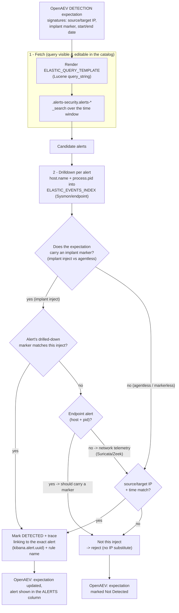

# OpenAEV Elastic Security Collector

The Elastic Security collector validates OpenAEV detection expectations against
[Elastic Security](https://www.elastic.co/security), Elastic's SIEM and security analytics solution built on the
Elastic Stack. After OpenAEV agents execute attacks, the collector queries the Elastic Security alerts index in
Elasticsearch and correlates the resulting detection alerts with the related injects to confirm whether the activity
was detected.

## Table of Contents

- [OpenAEV Elastic Security Collector](#openaev-elastic-security-collector)
  - [Table of Contents](#table-of-contents)
  - [Introduction](#introduction)
  - [Requirements](#requirements)
  - [Configuration variables](#configuration-variables)
    - [OpenAEV environment variables](#openaev-environment-variables)
    - [Base collector environment variables](#base-collector-environment-variables)
    - [Elastic collector environment variables](#elastic-collector-environment-variables)
  - [Deployment](#deployment)
    - [Docker Deployment](#docker-deployment)
    - [Manual Deployment](#manual-deployment)
  - [Usage](#usage)
  - [Behavior](#behavior)
  - [Customizing the alert query](#customizing-the-alert-query)
  - [Deployment prerequisites](#deployment-prerequisites)
  - [Required permissions and API endpoints](#required-permissions-and-api-endpoints)
  - [PKI authentication (client certificate)](#pki-authentication-client-certificate)
  - [Debugging](#debugging)
  - [Integration tests](#integration-tests)
  - [Additional information](#additional-information)

## Introduction

OpenAEV (Breach and Attack Simulation) raises "expectations" each time it executes an inject (a simulated attack) on an
endpoint: a DETECTION expectation (the security product should raise an alert) and/or a PREVENTION expectation (the
security product should block the action). This collector connects to Elastic Security, registers a `SecurityPlatform`
of type `SIEM`, and periodically reconciles those expectations with the detection alerts produced by Elastic Security,
marking each expectation as detected/not detected and attaching a trace that links back to the Elastic Security alerts
view in Kibana. Elastic Security is a detection source, so this collector validates DETECTION expectations only;
PREVENTION expectations are not supported.

## Requirements

- OpenAEV Platform >= 1.19.0
- An Elasticsearch cluster storing Elastic Security detection alerts (default index pattern `.alerts-security.alerts-*`)
- An Elasticsearch API key (preferred), a username/password pair, or a client certificate mapped by a PKI realm
  (self-managed / ECK only), with read access to that alerts index
- Optionally, a Kibana instance to build alert links in the expectation traces
- For a manual (non-Docker) deployment: Python 3.14 and [Poetry](https://python-poetry.org/) >= 2.1

## Configuration variables

The collector is configured either through environment variables (recommended, read from `docker-compose.yml` / the
`.env` file for a Docker deployment) or through a `config.yml` file (for a manual deployment). Copy the provided
`src/.env.sample` / `src/config.yml.sample` and fill in the values flagged with `ChangeMe`.

### OpenAEV environment variables

| Parameter         | config.yml          | Docker environment variable | Mandatory | Description                                                                              |
|-------------------|---------------------|-----------------------------|-----------|------------------------------------------------------------------------------------------|
| OpenAEV URL       | `openaev.url`       | `OPENAEV_URL`               | Yes       | The URL of the OpenAEV platform. Must be reachable from where the collector runs.        |
| OpenAEV Token     | `openaev.token`     | `OPENAEV_TOKEN`             | Yes       | The administrator token of the OpenAEV platform.                                         |
| OpenAEV Tenant ID | `openaev.tenant_id` | `OPENAEV_TENANT_ID`         | No        | Tenant identifier for multi-tenant deployments. When set, it must be a valid UUID.       |

### Base collector environment variables

| Parameter        | config.yml            | Docker environment variable | Default          | Mandatory | Description                                                                                            |
|------------------|-----------------------|-----------------------------|------------------|-----------|--------------------------------------------------------------------------------------------------------|
| Collector ID     | `collector.id`        | `COLLECTOR_ID`              | /                | Yes       | A unique `UUIDv4` identifier for this collector instance.                                               |
| Collector Name   | `collector.name`      | `COLLECTOR_NAME`            | Elastic Security | No        | The name of the collector as shown in OpenAEV.                                                          |
| Collector Period | `collector.period`    | `COLLECTOR_PERIOD`          | PT1M             | No        | Interval between two runs, as an ISO 8601 duration (e.g. `PT1M` = 1 minute).                            |
| Log Level        | `collector.log_level` | `COLLECTOR_LOG_LEVEL`       | error            | No        | Verbosity of the logs. One of `debug`, `info`, `warn`, `error`.                                         |
| Platform         | `collector.platform`  | `COLLECTOR_PLATFORM`        | SIEM             | No        | The `SecurityPlatform` type registered in OpenAEV. One of `EDR`, `XDR`, `SIEM`, `SOAR`, `NDR`, `ISPM`.  |

### Elastic collector environment variables

| Parameter    | config.yml             | Docker environment variable | Default                     | Mandatory   | Description                                                                                                                                                |
|--------------|------------------------|-----------------------------|-----------------------------|-------------|----------------------------------------------------------------------------------------------------------------------------------------------------------|
| Base URL     | `elastic.base_url`     | `ELASTIC_BASE_URL`          | `https://localhost:9200`    | Yes         | Base URL of the Elasticsearch API (e.g. `https://elastic.company.com:9200`).                                                                              |
| Authentication Type | `elastic.authentication_type` | `ELASTIC_AUTHENTICATION_TYPE` | / (inferred)     | No          | Authentication method: `API_KEY`, `USER_PASSWORD` or `PKI`. When unset, it is inferred: API key, then username/password, then client certificate. When set, the settings of that method are required and those of the other methods are ignored. |
| API Key      | `elastic.api_key`      | `ELASTIC_API_KEY`           | /                           | Conditional | Elasticsearch API key (preferred). When set, it is used instead of username/password.                                                                     |
| Username     | `elastic.username`     | `ELASTIC_USERNAME`          | /                           | Conditional | Username for HTTP basic authentication (used when no API key is set).                                                                                     |
| Password     | `elastic.password`     | `ELASTIC_PASSWORD`          | /                           | Conditional | Password for HTTP basic authentication.                                                                                                                   |
| Client Cert  | `elastic.client_cert`  | `ELASTIC_CLIENT_CERT`       | /                           | Conditional | PKI client certificate, as the **base64-encoded PEM file** (`base64 -w0 client.crt`), not a path. See [PKI authentication](#pki-authentication-client-certificate). |
| Client Key   | `elastic.client_key`   | `ELASTIC_CLIENT_KEY`        | /                           | Conditional | Unencrypted private key of the client certificate, as the **base64-encoded PEM file** (`base64 -w0 client.key`), not a path.                             |
| Alerts Index | `elastic.alerts_index` | `ELASTIC_ALERTS_INDEX`      | `.alerts-security.alerts-*` | No          | Index or index pattern to search for detection alerts.                                                                                                    |
| Query Template | `elastic.query_template` | `ELASTIC_QUERY_TEMPLATE` | / (built-in default)        | No          | Editable Lucene `query_string` used to fetch the candidate alerts. Empty uses the built-in default query. See [Customizing the alert query](#customizing-the-alert-query) for the default query, the placeholders and examples. |
| Events Index | `elastic.events_index` | `ELASTIC_EVENTS_INDEX`      | `logs-windows.sysmon_operational-*,logs-endpoint.events.process-*,logs-system.security-*` | No | Raw endpoint/process events index used by the source-event drilldown to recover the implant marker: Sysmon, Elastic Defend and the Windows Security channel (event 4688) by default. A host with no process-creation event there is correlated on IP + time. Set empty to disable the drilldown (IP + time correlation only). |
| Kibana URL   | `elastic.kibana_url`   | `ELASTIC_KIBANA_URL`        | /                           | No          | Kibana base URL used to build trace links. When unset, `base_url` is reused with its port rewritten to 5601; set it when Kibana is elsewhere.            |
| Verify SSL   | `elastic.verify_ssl`   | `ELASTIC_VERIFY_SSL`        | true                        | No          | Whether to verify the Elasticsearch TLS certificate. Prefer trusting the cluster CA via `ELASTIC_CA_CERT` over disabling this.                            |
| CA Cert      | `elastic.ca_cert`      | `ELASTIC_CA_CERT`           | /                           | No          | Path to a CA bundle (PEM) used to verify the Elasticsearch TLS certificate (for self-signed / private CAs). When set, it takes precedence over `ELASTIC_VERIFY_SSL`. |
| Time Window  | `elastic.time_window`  | `ELASTIC_TIME_WINDOW`       | PT1H                        | No          | Default search window when no date signatures are provided, as an ISO 8601 duration.                                                                      |
| Offset       | `elastic.offset`       | `ELASTIC_OFFSET`            | PT30S                       | No          | Delay between retry attempts to absorb alert ingestion latency, as an ISO 8601 duration.                                                                  |
| Max Retry    | `elastic.max_retry`    | `ELASTIC_MAX_RETRY`         | 3                           | No          | Maximum number of retry attempts after the initial query returns no results.                                                                              |

> Note: authentication is required. Provide `ELASTIC_API_KEY` (preferred), both `ELASTIC_USERNAME` and
> `ELASTIC_PASSWORD`, or both `ELASTIC_CLIENT_CERT` and `ELASTIC_CLIENT_KEY` (PKI). The collector fails to start if none
> is configured, or if `ELASTIC_AUTHENTICATION_TYPE` names a method whose settings are missing.

## Deployment

### Docker Deployment

Build the Docker image (or use the published `openaev/collector-elastic` image):

```shell
docker build . -t openaev/collector-elastic:latest
```

Create a `.env` file next to `docker-compose.yml` from `src/.env.sample` and fill in your values, then start the
collector with the provided `docker-compose.yml`, which reads the settings it lists from `.env` or from the shell:

```shell
cp src/.env.sample .env
docker compose up -d
```

Settings left out of `.env` keep the collector's defaults. A value written directly in the `environment` section of
`docker-compose.yml` (`VAR=value`) takes precedence over `.env`. To check what actually reached the collector:

```shell
docker compose exec collector-elastic env | grep -E '^(OPENAEV|COLLECTOR|ELASTIC)_'
```

If the cluster certificate is signed by a private CA (for instance one generated by `elasticsearch-certutil`), put the
CA bundle in `./certs/ca.pem`, uncomment the `volumes` block of `docker-compose.yml` and set
`ELASTIC_CA_CERT=/certs/ca.pem` in `.env`.

### Manual Deployment with Poetry

1. **Clone and Install Dependencies**:
   ```bash
   git clone <repository-url>
   cd <your-collector>
   poetry install
   ```

2. **Configure the Collector**:
- Copy `src/config.yml.sample` to `src/config.yml`
- Update configuration values or set environment variables

3. **Run the Collector**:
   ```bash
   # Using Poetry
   poetry run python -m src
   
   # Or 
   poetry run ElasticCollector

   # Or direct execution after installing the project and activating the virtual environment:
   ElasticCollector
   ```

For local development against a checkout of [client-python](https://github.com/OpenAEV-Platform/client-python),
The client-python repository must be cloned at the same level as the collectors repository, so that `../../client-python`
resolves correctly from the collector directory.

```
parent-directory/ 
├── collectors/
│   └── <your-collector>/
└── client-python/
```

Then install the local `client-python` version inside the <your-collector> environment:
```bash
poetry run pip install -e ../../client-python --force-reinstall
```
The `-e` option installs the package in editable mode, allowing local changes in `client-python` to be used immediately
without reinstalling the package.

## Usage

Once started, the collector registers itself (and its `SecurityPlatform`) in OpenAEV and then runs automatically every
`COLLECTOR_PERIOD`. No manual interaction is required: as soon as injects produce expectations bound to this collector,
they are reconciled on the next run.

## Behavior

Correlation is **deterministic**: it keys on the OpenAEV implant marker whenever the inject ran on an implant/agent, and
only falls back to IP + time where a marker is impossible.

- **Implant inject** (the expectation carries an implant marker): the marker is the key. A drilldown recovers the
  `oaev-implant-<inject>-agent-<agent>` lineage from the raw endpoint events, so two injects run on the same host in
  the same window are told apart. An **endpoint** alert (process context: `host.name` + `process.pid`) that does *not*
  carry this inject's marker is rejected - IP is **not** accepted as a substitute - so an unrelated same-host alert is
  never misattributed. Only **network** telemetry (Suricata/Zeek), which physically cannot carry an implant marker,
  falls back to source/target IP + time for that inject - as does an endpoint alert from a host whose process-creation
  events are not in `ELASTIC_EVENTS_INDEX` (the marker cannot be recovered there, so rejecting it would hide every
  detection of that host).
- **Agentless inject** (no implant marker, e.g. NetExec): there is a 0% chance of an implant marker on the endpoints,
  so correlation is source/target IP + time directly.



On each run, the collector:

1. Fetches the unfilled DETECTION expectations assigned to this collector. PREVENTION expectations are marked invalid
   (Elastic Security is detection-only).
2. **Fetch** — renders `ELASTIC_QUERY_TEMPLATE` (the visible, editable Lucene `query_string`; a broad multi-field
   default is used when unset) with the expectation's IPs / implant markers, and runs `POST /<alerts_index>/_search`
   over a sliding time window (`ELASTIC_TIME_WINDOW`). Editing the query in the catalog changes exactly this fetch.
3. **Drilldown** — for each candidate alert, looks up the source process in `ELASTIC_EVENTS_INDEX` by `host.name` +
   `process.pid` and recovers the `oaev-implant-<inject>-agent-<agent>` marker from the (parent) process command line.
   When the chain is broken (a process event is missing, including the alerting process itself), it uses the implant
   that ran on the same host just before the alert. Set `ELASTIC_EVENTS_INDEX` empty to disable this step.
4. **Correlate** — for an implant inject the alert's recovered marker MUST match: IP is not accepted as a substitute
   for an **endpoint** alert (an unrelated same-host alert is rejected, never misattributed); only **network** telemetry
   (no process context) and endpoint alerts of a host with no process-creation event in `ELASTIC_EVENTS_INDEX` fall
   back to IP + time. Agentless expectations use source/target IP + time directly. It
   retries up to `ELASTIC_MAX_RETRY` times, waiting `ELASTIC_OFFSET` and widening the window, to absorb detection
   latency.
5. **Report** — marks each matched DETECTION expectation `Detected` and submits an expectation trace that links to the
   exact matched alert (`kibana.alert.uuid`) with its rule name. Traces are submitted before the verdict updates so the
   evidence is never lost. Expectations still unmatched once the retry budget (`ELASTIC_MAX_RETRY` x `ELASTIC_OFFSET`)
   is exhausted are marked `Not Detected` on that run - the collector does not wait for OpenAEV's expiry.

> The **fetch query** (`ELASTIC_QUERY_TEMPLATE`) and the **drilldown index** (`ELASTIC_EVENTS_INDEX`) are configurable
> from the catalog or from the environment. The deterministic correlation algorithm itself (marker for implant injects,
> IP + time only where a marker is impossible) is collector logic, not an editable query.

## Customizing the alert query

`ELASTIC_QUERY_TEMPLATE` is the Lucene [`query_string`](https://www.elastic.co/docs/reference/query-languages/query-dsl/query-dsl-query-string-query)
that selects the **candidate alerts** of an expectation in `ELASTIC_ALERTS_INDEX`. Leave it empty to use the built-in
default below. The collector logs at startup which one it uses.

Where to set it:

- **Platform-managed collector (catalog):** the *Query template* field of the Elastic Security connector. Leave it empty
  to keep the built-in query, which then follows collector updates; to customize it, copy the default query shown in the
  field description and edit it. A query saved in the field is kept as is when the collector's default changes.
- **Docker:** `ELASTIC_QUERY_TEMPLATE` in `.env` (already passed to the container by `docker-compose.yml`), on a single
  line, unquoted or wrapped in single quotes. Docker Compose interpolates `$` (write `$$` for a literal `$`) and treats
  ` #` as the start of a comment.
- **Manual deployment:** `elastic.query_template` in `src/config.yml` (wrap the value in single quotes), or the same
  environment variable.

The query is read once at startup: restart the collector after changing it. With Docker Compose, run
`docker compose up -d`, which recreates the container with the new value (`docker compose restart` keeps the old one).
Check the startup log to confirm which query is used: `Using a custom query template from configuration` or `Using the built-in default query template`.

The collector reads a single configuration source, in this order: `src/.env` if it exists, otherwise `src/config.yml` if
it exists, otherwise the environment variables. A leftover `src/.env` or `src/config.yml` therefore hides every
environment variable, including `ELASTIC_QUERY_TEMPLATE`. The Docker image excludes both files, so a container always
reads its environment variables.

Built-in default query (one line in practice, wrapped here for readability):

```
(source.ip:({source_ips}) OR host.ip:({source_ips}) OR client.ip:({source_ips}))
OR (destination.ip:({target_ips}) OR server.ip:({target_ips}) OR host.ip:({target_ips}))
OR (url.path:({implant_urls}) OR url.original:({implant_urls}))
OR (process.name:({implant_names}) OR process.parent.name:({implant_names}) OR process.command_line:({implant_names}))
```

Placeholders, filled from the expectation's signatures:

| Placeholder       | Value                                                                                   |
|-------------------|-----------------------------------------------------------------------------------------|
| `{source_ips}`    | Source IPs of the expectation (typically the IPs of the asset the inject ran on)        |
| `{target_ips}`    | Target IPs of the inject                                                                |
| `{implant_names}` | Implant marker `oaev-implant-<inject>-agent-<agent>`                                    |
| `{implant_urls}`  | Implant payload path `/api/injects/<inject>/<agent>/executable-payload`                 |
| `{start_date}`    | Inject start date (ISO 8601), `*` when unknown                                          |
| `{end_date}`      | Inject end date (ISO 8601), `*` when unknown                                            |
| `{time_window}`   | `ELASTIC_TIME_WINDOW` in seconds                                                        |
| `{alerts_index}`  | `ELASTIC_ALERTS_INDEX`                                                                  |

How the query is run:

- Each list placeholder is rendered as an OR-joined set of quoted, escaped values (`"10.0.0.5" OR "fe80::1"`), so
  write `field:({placeholder})`. An empty list becomes `__oaev_no_match__`, which matches nothing, so its clause simply
  drops out.
- The time range is always added separately as an `@timestamp` filter over `ELASTIC_TIME_WINDOW` (widened on
  retries): do not add one yourself.
- The query runs with `lenient: true`, so a field missing from your mapping does not fail it.
- At most the 100 most recent matching alerts are fetched: a broad query can push the relevant alert out of them.
- The query only selects candidates. Each candidate is then checked by the correlation described in
  [Behavior](#behavior), so a query that is too broad does not credit unrelated alerts, it only costs more requests.
  An unknown placeholder makes the collector refuse to start.

Examples:

- Only consider open alerts, and ignore a noisy rule:

  ```
  ((source.ip:({source_ips}) OR host.ip:({source_ips})) OR (process.parent.name:({implant_names}) OR process.command_line:({implant_names}))) AND kibana.alert.workflow_status:open AND NOT kibana.alert.rule.name:"My noisy rule"
  ```

- Endpoint alerts only (EDR, Sysmon, Windows Security), matched on the host:

  ```
  host.ip:({source_ips}) OR process.parent.name:({implant_names}) OR process.command_line:({implant_names})
  ```

- Network alerts only (Suricata, Zeek, firewall):

  ```
  source.ip:({source_ips}) OR destination.ip:({target_ips}) OR url.original:({implant_urls})
  ```

## Deployment prerequisites

- **Elastic version:** Elastic Security 8.x or later (the collector reads `.alerts-security.alerts-*` and uses the
  `kibana.alert.url` field for trace links, both 8.x+). Confirm the alert schema on your version.
- **Runtime:** Python 3.14 (matching the published container image and the rest of the collectors monorepo); the image bundles it.
- **Detection content must be enabled.** The collector only correlates alerts your rules actually raise. Enable the
  Elastic **Detection rules** (and the **Elastic Defend**, **Sysmon via Elastic Agent** and/or **System** integrations)
  that fire on the behaviours you inject. If no rule fires for a technique, the inject is legitimately `Not Detected`.
- **Process telemetry for deterministic correlation (important).** Per-inject determinism relies on recovering the
  implant marker from raw **process-creation events** (the drilldown into `ELASTIC_EVENTS_INDEX`, default
  `logs-windows.sysmon_operational-*,logs-endpoint.events.process-*,logs-system.security-*`). Point it at the index that
  actually holds your endpoint process events:

  | Telemetry                                     | Process-creation events                      | Index                               |
  |-----------------------------------------------|----------------------------------------------|-------------------------------------|
  | Elastic Defend                                | process `start` events                       | `logs-endpoint.events.process-*`    |
  | Sysmon (Windows integration)                  | event 1                                      | `logs-windows.sysmon_operational-*` |
  | Windows Security channel (System integration) | event 4688 (needs *Audit Process Creation*)  | `logs-system.security-*`            |

  With the Windows Security channel, also enable *Include command line in process creation events* so the command
  lines are available. At startup the collector counts the process-creation events of the last 24h in this index and
  logs a warning when there are none. A host with no process-creation event there is correlated on source/target
  **IP + time** (lower confidence, cannot dissociate two injects on the same host in the same window).
  **SIEM-only deployments without process telemetry:** set `ELASTIC_EVENTS_INDEX=""` to disable the drilldown
  altogether; correlation then degrades to IP + time for every alert. This is logged at startup.

## Required permissions and API endpoints

The collector is **read-only** and needs no cluster or Kibana privileges. Prefer an **API key** (scoped, revocable) or a
**client certificate** (see [PKI authentication](#pki-authentication-client-certificate)) over basic auth; if you must
use basic auth, use a dedicated least-privilege service account, never a personal/admin user.

Grant `read` + `view_index_metadata` on the alerts index **and** the events index used by the drilldown:

```json
{
  "elastic-collector": {
    "cluster": [],
    "indices": [
      {
        "names": [".alerts-security.alerts-*",
                  "logs-windows.sysmon_operational-*",
                  "logs-endpoint.events.process-*"],
        "privileges": ["read", "view_index_metadata"]
      }
    ]
  }
}
```

- API endpoints used: `POST /<alerts_index>/_search` and `POST /<events_index>/_search`
  (`Authorization: ApiKey` header, HTTP basic auth, or a TLS client certificate). No Kibana API is called (trace links
  are only *built*).
- If the events-index read is **denied** (`401`/`403`) or the index does **not exist** (`404`), the drilldown does not
  silently degrade: the affected expectations are **left pending** (never graded as a false *Not Detected*) and an
  actionable error is logged each cycle. Fix it by granting the read, or by running in **SIEM-only mode** (set
  `ELASTIC_EVENTS_INDEX=""` above) so correlation intentionally degrades to IP + time.
- References: [Elasticsearch search API](https://www.elastic.co/guide/en/elasticsearch/reference/current/search-search.html),
  [Create API key](https://www.elastic.co/guide/en/elasticsearch/reference/current/security-api-create-api-key.html).

## PKI authentication (client certificate)

Instead of an API key or a password, the collector can authenticate with an X.509 client certificate through an
Elasticsearch [PKI realm](https://www.elastic.co/docs/deploy-manage/users-roles/cluster-or-deployment-auth/pki). The
certificate is presented during the TLS handshake and no `Authorization` header is sent. PKI realms are only available
on **self-managed and ECK** clusters, not on Elastic Cloud Hosted or Elastic Cloud Enterprise: use an API key there.

### Elasticsearch side

1. Request client certificates on the HTTP layer, trust the CA that signs them, and add a `pki` realm in
   `elasticsearch.yml`, then restart the nodes:

   ```yaml
   xpack.security.http.ssl.client_authentication: optional
   # CA that signs the client certificates (or xpack.security.http.ssl.truststore.path)
   xpack.security.http.ssl.certificate_authorities: ["certs/client-ca.crt"]
   # Only the realms listed here are used: keep the ones the cluster relies on.
   xpack.security.authc.realms.native.native1.order: 0
   xpack.security.authc.realms.pki.pki1.order: 1
   ```

   `optional` keeps the clients that authenticate with an API key or a password (Kibana, other integrations) working;
   `required` rejects every connection that presents no client certificate.

2. Give the certificate the collector's read-only role. A PKI user has no role until it is mapped. Create the
   `elastic-collector` role with `PUT /_security/role/elastic-collector`, using the `cluster` and `indices` of the
   descriptor in [Required permissions](#required-permissions-and-api-endpoints), then map the certificate's
   distinguished name to it:

   ```
   PUT /_security/role_mapping/openaev-collector-pki
   {
     "roles": ["elastic-collector"],
     "rules": { "field": { "dn": "CN=openaev-collector,OU=Security,O=Example" } },
     "enabled": true
   }
   ```

3. Check the identity seen by Elasticsearch:

   ```bash
   curl --cacert ca.crt --cert client.crt --key client.key https://elastic.company.com:9200/_security/_authenticate
   ```

   The response shows the certificate CN as `username`, a `pki` type under `authentication_realm`, the
   `elastic-collector` role, and the exact DN to use in the role mapping under `metadata.pki_dn`.

### Collector side

- The certificate must be signed by a CA the HTTP layer trusts, and its private key must be **unencrypted**:
  `requests` cannot load a passphrase-protected key.
- Pass the certificate and key as **base64-encoded PEM files** (values, not paths). The CA bundle that verifies the
  cluster certificate (`ELASTIC_CA_CERT`) stays a path:

  ```bash
  ELASTIC_AUTHENTICATION_TYPE=PKI
  ELASTIC_CLIENT_CERT="$(base64 -w0 client.crt)"
  ELASTIC_CLIENT_KEY="$(base64 -w0 client.key)"
  ELASTIC_CA_CERT=/certs/ca.crt
  ```

- Set `ELASTIC_AUTHENTICATION_TYPE=PKI`, or leave the API key and username/password unset: when the type is inferred,
  they take precedence over the certificate.
- At startup the collector decodes both values and checks that they are PEM files of the expected type. These checks
  only run when PKI is the method in effect. Because `requests` only loads client certificates from files, the
  collector then writes them to a new private temporary directory (`openaev-elastic-pki-*` under `$TMPDIR`, `/tmp` by
  default, mode `0700`, files mode `0600`), removed when the Python process exits normally. With a read-only root
  filesystem, mount a writable volume on `/tmp` (for example an `emptyDir` on Kubernetes) or point `TMPDIR` to one.
- **Kubernetes:** a Secret injected through `secretKeyRef` is base64-decoded by Kubernetes, so the Secret value must be
  the base64 string itself (for example under `stringData`).

## Tuning detection latency

The collector waits for an alert to appear after an inject, bounded by `ELASTIC_MAX_RETRY` × `ELASTIC_OFFSET`
(default `3 × 30s ≈ 90s`) and searched over `ELASTIC_TIME_WINDOW` (default `PT1H`).

- Too short → **premature `Not Detected`** if your rules run on a slower schedule (SIEM ingestion + rule interval).
  A verdict is recorded once and not re-evaluated, so an alert that fires *after* the budget is exhausted is missed
  even though it exists — size the budget for your **slowest** relevant rule, not the average.
- Too long → slower cycles (the batch is sequential; see Known limitations).

| Cluster detection latency | Suggested settings |
|---|---|
| Fast (rules ~1 min) | `ELASTIC_MAX_RETRY=3`, `ELASTIC_OFFSET=PT30S` (default) |
| Moderate (a few min) | `ELASTIC_MAX_RETRY=4`, `ELASTIC_OFFSET=PT45S` |
| High-latency (e.g. PowerShell script-block / high-entropy rules) | `ELASTIC_MAX_RETRY=8`, `ELASTIC_OFFSET=PT30S` (~4 min) |
| Very high | raise `ELASTIC_TIME_WINDOW` (coverage) and the budget; expect slower cycles |

> **Note on script-based rules.** Detections built on PowerShell script-block / high-entropy analysis (e.g.
> *"Potential Invoke-Mimikatz PowerShell Script"*, *"PowerShell Obfuscated Script via High Entropy"*) can fire **one to
> several minutes after** the technique runs — well beyond the 90 s default. If injects that clearly executed are graded
> `Not Detected`, raise the retry budget (the `~4 min` row above) before suspecting the correlation logic.

`ELASTIC_TIME_WINDOW` (not the offset) governs how far back alerts are searched.

## Trace links

Trace links open the exact matched alert. The collector uses the alert's canonical `kibana.alert.url` (generated by
Kibana from **`server.publicBaseUrl`** — set that in your Kibana). If `publicBaseUrl` is wrong/unset for your topology
(e.g. reverse proxy), set `ELASTIC_KIBANA_URL` to the reachable Kibana base URL and the link host is rebased onto it.
Only `http(s)` links are ever emitted, any embedded credentials are stripped, and — because `kibana.alert.url` comes from
an alert document — when `ELASTIC_KIBANA_URL` is unset the host is trusted only if it matches the Elasticsearch host (a
co-located Kibana); an unverifiable host falls back to a collector-built link. Set `ELASTIC_KIBANA_URL` to trust a
separate Kibana host.

## Security notes

- **TLS on by default** (`ELASTIC_VERIFY_SSL=true`). For self-signed clusters, trust the CA via `ELASTIC_CA_CERT`
  (a bundle path) rather than disabling verification. `ELASTIC_VERIFY_SSL=false` is a **lab-only** downgrade that exposes
  credentials to interception and logs a loud warning.
- Put credentials in `ELASTIC_API_KEY` / `ELASTIC_USERNAME` / `ELASTIC_PASSWORD`, **not** inline in `ELASTIC_BASE_URL`.
- With PKI, the decoded private key is written to a private temporary directory (mode `0700`, file mode `0600`) that
  is removed when the Python process exits normally. A collector stopped by a signal (for example `docker stop`) leaves
  it behind until the container is removed: keep `/tmp` private to the container.
- `debug` logging records hostnames, IPs and alert links; enable it transiently and keep logs on-host.

## Debugging

At startup the collector checks both connections, so you can tell them apart before running any inject:

- **OpenAEV**: `Connected to OpenAEV at <url>: collector registered` (info) once the collector is registered. If
  OpenAEV is unreachable, setup fails instead. Afterwards, the keep-alive ping only logs failures
  (`Error pinging the API: ...`).
- **Elastic**: the collector counts the alerts index once. On success it logs
  `Connected to Elastic at <url>: N alert(s) in '<index>'` (info). On failure it logs
  `Elastic connectivity check failed ...` (error, so it shows at the default level) with the reason: network, TLS,
  `401`/`403` or `404`. The collector keeps running, and Elastic is queried again when expectations come in.

Set `COLLECTOR_LOG_LEVEL=debug` for verbose logs (expectation polling, the queries issued, matching decisions). Common
causes of "nothing detected": wrong `ELASTIC_ALERTS_INDEX`; a `ELASTIC_TIME_WINDOW` shorter than your ingestion latency;
or no detection rule enabled for the technique. A denied read (`401`/`403`) or missing index (`404`) — on the alerts index
or the events index used by the drilldown — surfaces an actionable error and leaves the affected expectations **pending**
(re-served next cycle) rather than grading a silent false *Not Detected*.

## Integration tests

`tests_integration/` holds tests that send real requests to an Elasticsearch cluster. They are marked `integration` and
are never run by `poetry run pytest` (unit tests only).

`test_api_authentication_integration.py` sends an HTTPS `GET` to `ELASTIC_SEARCH_URL` with each authentication method
and checks that:

- valid credentials (API key, username/password, PKI client certificate) get a `200`;
- an unknown API key and a wrong password get a `4XX`;
- a self-signed client certificate (generated with `openssl`) is refused by the server during the TLS handshake. No HTTP
  status exists in that case, so the test expects an `SSLError` carrying the server's TLS alert.

Parameters are read from `tests_integration/integration_test.env` only (shell variables are ignored). The file is
git-ignored. Relative paths in it are resolved from `tests_integration/`.

| Parameter            | Description                                                               |
|----------------------|---------------------------------------------------------------------------|
| `ELASTIC_SEARCH_URL` | Endpoint the tests `GET`, e.g. `https://localhost:9200/_security/_authenticate` |
| `CA_CERT_PATH`       | CA certificate that signed the cluster HTTP certificate                   |
| `ELASTIC_USER`       | Username for basic authentication                                         |
| `ELASTIC_PASSWORD`   | Password for basic authentication                                         |
| `ELASTIC_API_KEY`    | Encoded API key (base64 of `id:api_key`)                                  |
| `ELASTIC_CERT_PATH`  | PKI client certificate, signed by a CA the PKI realm trusts               |
| `ELASTIC_KEY_PATH`   | Private key of the PKI client certificate                                 |

From the `elastic/` directory:

```bash
cp tests_integration/integration_test.env.sample tests_integration/integration_test.env  # then fill it in
poetry run pytest tests_integration -m integration -v
```

## Known limitations (current)

These are current constraints of the shared collector framework; the SDK rework is the roadmap.

- **Throughput:** expectations are processed **sequentially** with per-expectation retry (blocking). High-volume cycles
  are slow and cannot overlap the poll period; fresh injects can queue behind a large backlog.
- **No persistence/idempotency across restarts**; a mid-cycle crash re-processes next start.
- **Detection only** — PREVENTION expectations are not supported.
- Candidate alerts per expectation are capped, and the per-expectation drilldown fan-out is bounded, to protect the
  cluster; extremely noisy environments should tune detection rules to reduce alert volume.

## Additional information

- The collector reads only a recent sliding window; it validates expectations shortly after an inject, not historically.
- Transient SIEM/API outages leave an expectation **pending** (re-tried next cycle), never a false `Not Detected`.
- Permissions/endpoints reflect the current implementation; confirm against Elastic's official docs before deploying.
