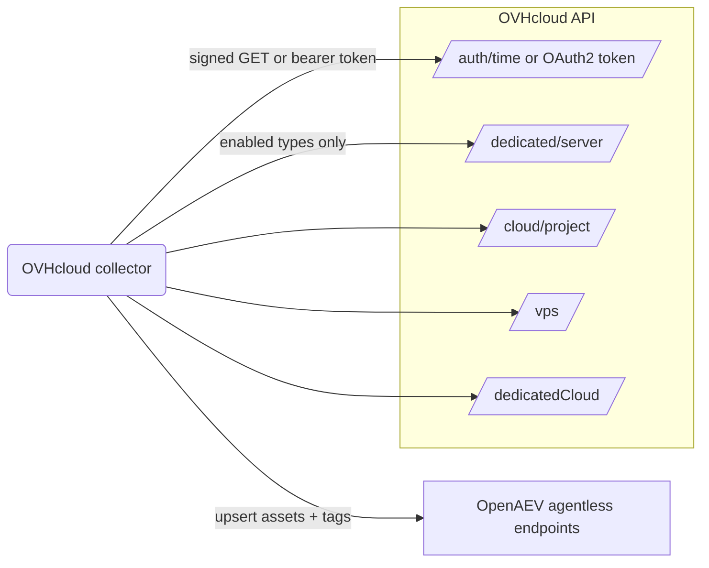

# OpenAEV OVHcloud Collector

The OVHcloud collector imports your [OVHcloud](https://www.ovhcloud.com/) machines into OpenAEV as agentless
endpoints: dedicated servers (bare metal), Public Cloud instances, VPS and Hosted Private Cloud (VMware) virtual
machines. What it collects is configurable per resource type, with region, name, IAM tag and IP filters. On each run it
reads the OVHcloud API and creates or updates a matching OpenAEV asset (endpoint) for every machine kept, so your
simulation scope stays aligned with your OVHcloud inventory. This collector imports inventory only and does not
validate detection or prevention expectations.

## Table of Contents

- [OpenAEV OVHcloud Collector](#openaev-ovhcloud-collector)
  - [Table of Contents](#table-of-contents)
  - [Introduction](#introduction)
  - [Requirements](#requirements)
  - [Configuration variables](#configuration-variables)
    - [OpenAEV environment variables](#openaev-environment-variables)
    - [Base collector environment variables](#base-collector-environment-variables)
    - [OVHcloud API access](#ovhcloud-api-access)
    - [What to collect](#what-to-collect)
    - [Filters](#filters)
    - [IP addresses](#ip-addresses)
    - [Tagging and tuning](#tagging-and-tuning)
  - [Creating the API credentials](#creating-the-api-credentials)
  - [Deployment](#deployment)
    - [Docker Deployment](#docker-deployment)
    - [Manual Deployment with Poetry](#manual-deployment-with-poetry)
  - [Usage](#usage)
  - [Behavior](#behavior)
  - [Asset mapping](#asset-mapping)
  - [Required permissions and API endpoints](#required-permissions-and-api-endpoints)
  - [Debugging](#debugging)
  - [Additional information](#additional-information)

## Introduction

OpenAEV executes injects (simulated attacks) against assets. To run those simulations against the machines you host at
OVHcloud, OpenAEV needs to know which machines exist. This collector authenticates to the OVHcloud API with read-only
credentials, lists the resource types you enabled (dedicated servers by default), resolves their IP addresses and
operating system, and registers each machine as an agentless endpoint in OpenAEV (name, hostname, platform,
architecture, IP addresses, cloud metadata and tags). It performs a full inventory synchronization on every run:
machines are upserted (created or updated) so existing assets are kept current.

## Requirements

- OpenAEV Platform >= 1.19.0
- An OVHcloud account, with either:
  - an application key, an application secret and a consumer key granted the read-only access rules listed in
    [Required permissions](#required-permissions-and-api-endpoints), or
  - an OAuth2 service account (client id and client secret) whose IAM policy grants the same read actions
- For a manual (non-Docker) deployment: Python >= 3.14 and [Poetry](https://python-poetry.org/) >= 2.1

## Configuration variables

The collector is configured either through environment variables (recommended, read from `docker-compose.yml` / the
`.env` file for a Docker deployment) or through a `config.yml` file (for a manual deployment). Copy the provided
`.env.sample` / `config.yml.sample` and fill in the values flagged with `ChangeMe`.

### OpenAEV environment variables

| Parameter         | config.yml          | Docker environment variable | Mandatory | Description                                                                        |
|-------------------|---------------------|-----------------------------|-----------|------------------------------------------------------------------------------------|
| OpenAEV URL       | `openaev.url`       | `OPENAEV_URL`               | Yes       | The URL of the OpenAEV platform. Must be reachable from where the collector runs.  |
| OpenAEV Token     | `openaev.token`     | `OPENAEV_TOKEN`             | Yes       | The administrator token of the OpenAEV platform.                                   |
| OpenAEV Tenant ID | `openaev.tenant_id` | `OPENAEV_TENANT_ID`         | No        | Tenant identifier for multi-tenant deployments. When set, it must be a valid UUID. |

### Base collector environment variables

| Parameter        | config.yml            | Docker environment variable | Default  | Mandatory | Description                                                                 |
|------------------|-----------------------|-----------------------------|----------|-----------|-----------------------------------------------------------------------------|
| Collector ID     | `collector.id`        | `COLLECTOR_ID`              | /        | Yes       | A unique `UUIDv4` identifier for this collector instance.                    |
| Collector Name   | `collector.name`      | `COLLECTOR_NAME`            | OVHcloud | No        | The name of the collector as shown in OpenAEV.                               |
| Collector Period | `collector.period`    | `COLLECTOR_PERIOD`          | PT1H     | No        | Interval between two runs, as an ISO 8601 duration (e.g. `PT1H` = 1 hour).   |
| Log Level        | `collector.log_level` | `COLLECTOR_LOG_LEVEL`       | error    | No        | Verbosity of the logs. One of `debug`, `info`, `warn`, `error`.             |

### OVHcloud API access

Provide **either** the three application credentials **or** the two OAuth2 service account credentials. The collector
refuses to start with an incomplete set.

| Parameter          | config.yml                              | Docker environment variable               | Default  | Mandatory   | Description                                                                 |
|--------------------|-----------------------------------------|-------------------------------------------|----------|-------------|-----------------------------------------------------------------------------|
| API endpoint       | `collector.ovhcloud_endpoint`           | `COLLECTOR_OVHCLOUD_ENDPOINT`             | `ovh-eu` | No          | `ovh-eu` (Europe), `ovh-ca` (Canada / Asia-Pacific) or `ovh-us` (US).        |
| Application key    | `collector.ovhcloud_application_key`    | `COLLECTOR_OVHCLOUD_APPLICATION_KEY`      | /        | Conditional | Application key. Required with the application secret and consumer key.     |
| Application secret | `collector.ovhcloud_application_secret` | `COLLECTOR_OVHCLOUD_APPLICATION_SECRET`   | /        | Conditional | Application secret.                                                         |
| Consumer key       | `collector.ovhcloud_consumer_key`       | `COLLECTOR_OVHCLOUD_CONSUMER_KEY`         | /        | Conditional | Consumer key, granted the read-only access rules below.                     |
| OAuth2 client id   | `collector.ovhcloud_client_id`          | `COLLECTOR_OVHCLOUD_CLIENT_ID`            | /        | Conditional | Service account client id. Required with the client secret.                 |
| OAuth2 secret      | `collector.ovhcloud_client_secret`      | `COLLECTOR_OVHCLOUD_CLIENT_SECRET`        | /        | Conditional | Service account client secret.                                              |

### What to collect

Each resource type is a toggle. Only dedicated servers are collected by default: the other types are opt-in, so a first
deployment imports the bare metal inventory alone.

| Parameter                 | config.yml                                        | Docker environment variable                         | Default | Description                                         |
|---------------------------|---------------------------------------------------|-----------------------------------------------------|---------|-----------------------------------------------------|
| Dedicated servers         | `collector.ovhcloud_collect_dedicated_servers`    | `COLLECTOR_OVHCLOUD_COLLECT_DEDICATED_SERVERS`      | true    | Bare metal servers (`/dedicated/server`).           |
| Public Cloud instances    | `collector.ovhcloud_collect_public_cloud`         | `COLLECTOR_OVHCLOUD_COLLECT_PUBLIC_CLOUD`           | false   | Instances of every (or the listed) Public Cloud project. |
| VPS                       | `collector.ovhcloud_collect_vps`                  | `COLLECTOR_OVHCLOUD_COLLECT_VPS`                    | false   | Virtual private servers (`/vps`).                   |
| Hosted Private Cloud VMs  | `collector.ovhcloud_collect_hosted_private_cloud` | `COLLECTOR_OVHCLOUD_COLLECT_HOSTED_PRIVATE_CLOUD`   | false   | VMware virtual machines (`/dedicatedCloud`).        |

### Filters

All filters are optional and combine (a machine must pass every filter set).

| Parameter               | config.yml                                    | Docker environment variable                    | Default | Description                                                                                                                                   |
|-------------------------|-----------------------------------------------|------------------------------------------------|---------|-----------------------------------------------------------------------------------------------------------------------------------------------|
| Public Cloud projects   | `collector.ovhcloud_public_cloud_project_ids`  | `COLLECTOR_OVHCLOUD_PUBLIC_CLOUD_PROJECT_IDS`  | /       | Comma-separated project ids. Empty: every project the credentials can read.                                                                    |
| Regions / datacenters   | `collector.ovhcloud_regions`                  | `COLLECTOR_OVHCLOUD_REGIONS`                   | /       | Comma-separated values, case-insensitive, matched against the region (`eu-west-rbx`, `GRA11`) or the datacenter (`rbx8`, `sbg`). Empty: all. |
| Name include            | `collector.ovhcloud_name_include`             | `COLLECTOR_OVHCLOUD_NAME_INCLUDE`              | /       | Regular expression: keep only the machines whose display name, service name or hostname matches it.                                           |
| Name exclude            | `collector.ovhcloud_name_exclude`             | `COLLECTOR_OVHCLOUD_NAME_EXCLUDE`              | /       | Regular expression: drop the machines whose display name, service name or hostname matches it.                                                |
| IAM tags                | `collector.ovhcloud_iam_tags`                 | `COLLECTOR_OVHCLOUD_IAM_TAGS`                  | /       | Comma-separated `key=value` pairs; a machine is kept only when it carries all of them (Public Cloud: the project's tags).                       |
| Skip inactive           | `collector.ovhcloud_skip_inactive`            | `COLLECTOR_OVHCLOUD_SKIP_INACTIVE`             | true    | Skip suspended or expired services, servers not in state `ok`, deleted or errored instances and deleted VMs.                                  |

### IP addresses

| Parameter            | config.yml                              | Docker environment variable              | Default | Description                                                                                       |
|----------------------|-----------------------------------------|------------------------------------------|---------|---------------------------------------------------------------------------------------------------|
| Public IPv4          | `collector.ovhcloud_include_public_ipv4` | `COLLECTOR_OVHCLOUD_INCLUDE_PUBLIC_IPV4` | true    | Register public IPv4 addresses.                                                                   |
| Public IPv6          | `collector.ovhcloud_include_public_ipv6` | `COLLECTOR_OVHCLOUD_INCLUDE_PUBLIC_IPV6` | true    | Register public IPv6 addresses.                                                                   |
| Private addresses    | `collector.ovhcloud_include_private_ips` | `COLLECTOR_OVHCLOUD_INCLUDE_PRIVATE_IPS` | true    | Register private addresses (vRack, Public Cloud private networks).                               |

Only single addresses are registered on an endpoint. Routed blocks (the IPv6 `/64` of a dedicated server, failover IP
blocks) are not host addresses: they are kept in the asset metadata under `routed_blocks`.

### Tagging and tuning

| Parameter        | config.yml                        | Docker environment variable        | Default | Description                                                                          |
|------------------|-----------------------------------|------------------------------------|---------|--------------------------------------------------------------------------------------|
| Import OVH tags  | `collector.ovhcloud_import_tags`  | `COLLECTOR_OVHCLOUD_IMPORT_TAGS`   | true    | Add the OVHcloud IAM tags of a machine as OpenAEV tags (`ovh-<key>:<value>`).          |
| Max workers      | `collector.ovhcloud_max_workers`  | `COLLECTOR_OVHCLOUD_MAX_WORKERS`   | 5       | Maximum concurrent detail calls to the OVHcloud API (1 to 20).                       |

## Creating the API credentials

**Application key, secret and consumer key.** Create them at `https://eu.api.ovh.com/createToken/` (use
`ca.api.ovh.com` or `api.us.ovhcloud.com` for the other endpoints), with an unlimited or long validity and only the
`GET` rules listed below. The consumer key is bound to those rules: the collector cannot change anything on the account.

**OAuth2 service account.** Create a service account (`POST /me/api/oauth2/client`, flow `CLIENT_CREDENTIALS`) and
attach an IAM policy that allows the read actions of the resource types you collect (for example
`dedicatedServer:apiovh:get`, `dedicatedServer:apiovh:ips/get`, `publicCloudProject:apiovh:get`,
`publicCloudProject:apiovh:instance/get`, `vps:apiovh:get`, `vps:apiovh:ips/get`, `vps:apiovh:images/current/get`,
`pccVMware:apiovh:get`, `pccVMware:apiovh:datacenter/get`, `pccVMware:apiovh:datacenter/vm/get`).

## Deployment

### Docker Deployment

Build the Docker image (or use the published `openaev/collector-ovhcloud` image):

```shell
docker build . -t openaev/collector-ovhcloud:latest
```

Create a `.env` file from `.env.sample` and fill in your values, then start the collector with the provided
`docker-compose.yml` (which reads those variables):

```shell
docker compose up -d
```

### Manual Deployment with Poetry

1. **Clone and Install Dependencies**:
   ```bash
   git clone <repository-url>
   cd collectors/ovhcloud
   poetry install
   ```

2. **Configure the Collector**:
- Copy `ovhcloud/config.yml.sample` to `ovhcloud/config.yml`
- Update configuration values or set environment variables

3. **Run the Collector**:
   ```bash
   # Using Poetry
   poetry run python -m ovhcloud

   # Or
   poetry run OvhcloudCollector
   ```

## Usage

Once started, the collector registers itself in OpenAEV and then runs automatically every `COLLECTOR_PERIOD`. No manual
interaction is required: on each run it performs a full inventory synchronization of the enabled OVHcloud resource
types into OpenAEV assets. Because the period defaults to one hour (`PT1H`), new machines appear at the next scheduled
run.

## Behavior



On each run, the collector:

1. Authenticates: with application keys, every request is signed (`X-Ovh-Signature`) with a timestamp aligned on the
   OVHcloud server clock (`GET /auth/time`); with a service account, it fetches an OAuth2 bearer token (client
   credentials) and refreshes it before it expires.
2. For each enabled resource type, lists the services and reads their details, with at most `ovhcloud_max_workers`
   detail calls in flight. Throttling (`429`) and server errors (`5xx`) are retried with exponential backoff (honouring
   `Retry-After`); a machine whose detail call still fails is skipped and logged, and a resource type that fails as a
   whole does not stop the other types.
3. Applies the filters (inactive services, regions, name expressions, IAM tags) and the IP options.
4. Upserts each machine as an OpenAEV agentless endpoint, using the OVHcloud service name (or the instance / VM id) as
   the external reference, so a machine seen in a previous run is updated rather than duplicated.
5. Creates and attaches tags: `source:ovhcloud`, `ovh-type:<resource type>`, `region:<region>`,
   `datacenter:<datacenter>`, `ovh-project:<project id>` (Public Cloud) and, when `ovhcloud_import_tags` is on, the
   machine's IAM tags (OVHcloud system tags `ovh:*` excluded). Each tag is upserted once per run.

## Asset mapping

| OpenAEV field              | Dedicated server                                 | Public Cloud instance                      | VPS                                  | Hosted Private Cloud VM                     |
|----------------------------|--------------------------------------------------|--------------------------------------------|--------------------------------------|---------------------------------------------|
| `asset_name`               | IAM display name, else service name              | Instance name                              | Display name, else service name      | VM name                                     |
| `asset_hostname`           | Reverse DNS when set, else service name          | Instance name                              | Service name                         | VMware host name, else VM name              |
| `endpoint_platform`        | From `os` (Linux, Windows, Generic, Unknown)     | From the image and flavor OS type          | From the current image               | From the guest OS family                    |
| `endpoint_arch`            | From `os` (`_64` → x86_64, `arm64` → arm64)      | From the image name, else x86_64           | From the current image               | Unknown (not exposed by the API)            |
| `asset_ips`                | `ip` and the single addresses of `/ips`          | `ipAddresses`                              | `/ips`                               | None (the API exposes MAC addresses only)   |
| `asset_external_reference` | Service name                                     | Instance id                                | Service name                         | `<service>/<datacenterId>/<vmId>`           |
| `asset_subcategory`        | `SERVER`                                         | `VIRTUAL_MACHINE`                          | `VIRTUAL_MACHINE`                    | `VIRTUAL_MACHINE`                           |
| `asset_cloud_region`       | Region (e.g. `eu-west-rbx`)                      | Region (e.g. `GRA11`)                      | Zone                                 | Service location                            |

Every asset has category `HOST`, cloud provider `OTHER` (OpenAEV has no OVHcloud value yet), a cloud native type
(`ovh_dedicated_server`, `ovh_public_cloud_instance`, `ovh_vps`, `ovh_hosted_private_cloud_vm`) and `asset_metadata`
carrying `provider: ovhcloud` and the OVHcloud details (commercial range, datacenter, rack, OS, project, flavor, image,
model, power state, routed blocks).

## Required permissions and API endpoints

The collector only issues `GET` requests. Grant the consumer key these access rules (drop the rules of the types you do
not collect):

```
GET /auth/time
GET /dedicated/server
GET /dedicated/server/*
GET /cloud/project
GET /cloud/project/*
GET /vps
GET /vps/*
GET /dedicatedCloud
GET /dedicatedCloud/*
```

API endpoints used:

- `GET /auth/time` (server clock, application keys only)
- `GET /dedicated/server`, `GET /dedicated/server/{serviceName}`, `GET /dedicated/server/{serviceName}/ips`
- `GET /cloud/project`, `GET /cloud/project/{serviceName}`, `GET /cloud/project/{serviceName}/instance`
- `GET /vps`, `GET /vps/{serviceName}`, `GET /vps/{serviceName}/ips`, `GET /vps/{serviceName}/images/current`
- `GET /dedicatedCloud`, `GET /dedicatedCloud/{serviceName}`, `GET /dedicatedCloud/{serviceName}/datacenter`,
  `GET /dedicatedCloud/{serviceName}/datacenter/{datacenterId}`,
  `GET /dedicatedCloud/{serviceName}/datacenter/{datacenterId}/vm`,
  `GET /dedicatedCloud/{serviceName}/datacenter/{datacenterId}/vm/{vmId}`
- Reference: [OVHcloud API console](https://eu.api.ovh.com/console/)

## Debugging

Set `COLLECTOR_LOG_LEVEL=debug` to get verbose logs, including the retried calls, the number of machines kept per
resource type and each endpoint upsert. Common issues:

- `HTTP 403 This call has not been granted`: the consumer key (or the service account policy) lacks the access rule of
  that path; add it from the list above.
- `HTTP 400 Invalid signature` or `Query out of time`: check the application secret and consumer key; the collector
  aligns its clock on `/auth/time`, so a skewed host clock is not the cause.
- No machine imported: check the toggles, then loosen the filters (an IAM tag filter keeps only machines carrying every
  listed tag) and `ovhcloud_skip_inactive`.

## Additional information

- The collector performs a full inventory synchronization on every run; it does not delete OpenAEV assets when a
  machine disappears from OVHcloud.
- Hosted Private Cloud VMs are registered with their MAC addresses and no IP, as the OVHcloud API does not expose the
  guest IP addresses.
- The required permissions and endpoints reflect the current implementation. OVHcloud may change its API over time, so
  always confirm against the official documentation before deploying.
