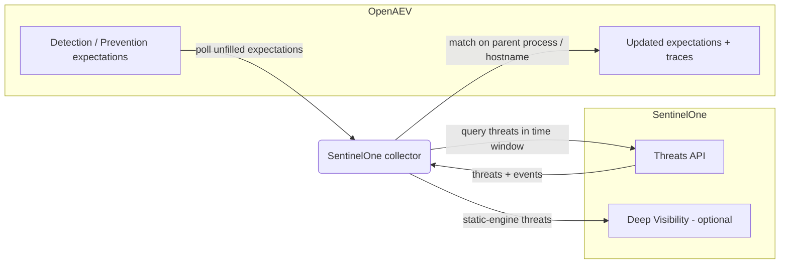
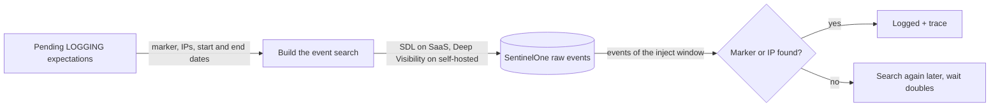

# OpenAEV SentinelOne Collector

The SentinelOne collector validates OpenAEV detection, prevention and logging expectations against
[SentinelOne](https://www.sentinelone.com/), SentinelOne's autonomous endpoint detection and response (EDR/XDR)
platform. After OpenAEV agents execute attacks, the collector polls the SentinelOne Threats API (and, optionally, Deep
Visibility) and correlates the resulting threats with the related injects to confirm whether the activity was detected
and/or prevented. When Logging is enabled, it also searches the raw events recorded by the SentinelOne agent to confirm
that the activity was logged, even when no threat or alert was raised.

## Table of Contents

- [OpenAEV SentinelOne Collector](#openaev-sentinelone-collector)
  - [Table of Contents](#table-of-contents)
  - [Introduction](#introduction)
  - [Requirements](#requirements)
  - [Configuration variables](#configuration-variables)
    - [OpenAEV environment variables](#openaev-environment-variables)
    - [Base collector environment variables](#base-collector-environment-variables)
    - [SentinelOne collector environment variables](#sentinelone-collector-environment-variables)
  - [Deployment](#deployment)
    - [Docker Deployment](#docker-deployment)
    - [Manual Deployment](#manual-deployment)
  - [Usage](#usage)
  - [Behavior](#behavior)
    - [Detection and prevention expectations](#detection-and-prevention-expectations)
    - [Logging expectations](#logging-expectations)
  - [Required permissions and API endpoints](#required-permissions-and-api-endpoints)
  - [Debugging](#debugging)
  - [Additional information](#additional-information)

## Introduction

OpenAEV (Breach and Attack Simulation) raises "expectations" each time it executes an inject (a simulated attack) on an
endpoint: a DETECTION expectation (the security product should raise an alert), a PREVENTION expectation (the
security product should block the action) and/or a LOGGING expectation (the action should at least appear in the
logs). This collector connects to the SentinelOne Management Console, registers a
`SecurityPlatform` of type `EDR`, and periodically reconciles those expectations with the threats produced by
SentinelOne, marking each expectation as detected/not detected and prevented/not prevented and attaching a trace that
links back to the originating SentinelOne threat. When Logging is enabled, it also marks LOGGING expectations as
`Logged`, with a trace that links to the matching events in the SentinelOne Event Search.

## Requirements

- OpenAEV Platform >= 1.19.0
- A SentinelOne Management Console with API access
- A SentinelOne API token with the `Threats` and `Threat Events` permissions (Deep Visibility and a Complete license are
  additionally required to validate static-engine detections)
- For LOGGING expectations (optional): the same token with access to the raw-event search (Event Search / Singularity
  Data Lake on SaaS, Deep Visibility on self-hosted), on the account or site that holds the endpoints
- An allowlisting SentinelOne-side of the OpenAEV agent (not the OpenAEV implant) and of the powershell used to start the implant/the executor*
- For a manual (non-Docker) deployment: Python >= 3.14 and [Poetry](https://python-poetry.org/) >= 2.1

* practical tip: a first run of an atomic testing can be used to flag the OpenAEV agent and the powershell process in SentinelOne, and then use the web interface of SentinelOne to flag them as false positive and to indicate they should run

## Configuration variables

The collector is configured either through environment variables (recommended, read from the `.env` file for a Docker
deployment) or through a `config.yml` file (for a manual deployment). Copy the provided `src/.env.sample` /
`src/config.yml.sample` and fill in the values flagged with `ChangeMe`.

### OpenAEV environment variables

| Parameter         | config.yml          | Docker environment variable | Mandatory | Description                                                                              |
|-------------------|---------------------|-----------------------------|-----------|------------------------------------------------------------------------------------------|
| OpenAEV URL       | `openaev.url`       | `OPENAEV_URL`               | Yes       | The URL of the OpenAEV platform. Must be reachable from where the collector runs.        |
| OpenAEV Token     | `openaev.token`     | `OPENAEV_TOKEN`             | Yes       | The administrator token of the OpenAEV platform.                                         |
| OpenAEV Tenant ID | `openaev.tenant_id` | `OPENAEV_TENANT_ID`         | No        | Tenant identifier for multi-tenant deployments. When set, it must be a valid UUID.       |

### Base collector environment variables

| Parameter        | config.yml            | Docker environment variable | Default     | Mandatory | Description                                                                                  |
|------------------|-----------------------|-----------------------------|-------------|-----------|----------------------------------------------------------------------------------------------|
| Collector ID     | `collector.id`        | `COLLECTOR_ID`              | /           | Yes       | A unique `UUIDv4` identifier for this collector instance.                                     |
| Collector Name   | `collector.name`      | `COLLECTOR_NAME`            | SentinelOne | No        | The name of the collector as shown in OpenAEV.                                                |
| Collector Period | `collector.period`    | `COLLECTOR_PERIOD`          | PT2M        | No        | Interval between two runs, as an ISO 8601 duration (e.g. `PT2M` = 2 minutes).                 |
| Log Level        | `collector.log_level` | `COLLECTOR_LOG_LEVEL`       | error       | No        | Verbosity of the logs. One of `debug`, `info`, `warn`, `error`.                               |
| Platform         | `collector.platform`  | `COLLECTOR_PLATFORM`        | EDR         | No        | The `SecurityPlatform` type registered in OpenAEV. One of `EDR`, `XDR`, `SIEM`, `SOAR`, `NDR`, `ISPM`. |

### SentinelOne collector environment variables

| Parameter | config.yml             | Docker environment variable | Default                       | Mandatory | Description                                                                |
|-----------|------------------------|-----------------------------|-------------------------------|-----------|----------------------------------------------------------------------------|
| Base URL  | `sentinelone.base_url` | `SENTINELONE_BASE_URL`      | `https://api.sentinelone.com` | No        | The SentinelOne Management Console API base URL.                           |
| API Key   | `sentinelone.api_key`  | `SENTINELONE_API_KEY`       | /                             | Yes       | The SentinelOne API token with `Threats` and `Threat Events` permissions.  |
| Enable Unified Alerts | `sentinelone.enable_alerts` | `SENTINELONE_ENABLE_ALERTS` | `true` | No | Also correlate Unified Alerts (behavioral / STAR / AI detections that never become Threats). SaaS only, ignored on self-hosted. If the token is refused (HTTP 401/403) the correlation is disabled for the run with a single warning; Threats keep working. |
| Retry Window | `sentinelone.retry_window` | `SENTINELONE_RETRY_WINDOW` | `PT10M` | No | How long an expectation hit by a transient API failure (timeout, 408/429, 5xx) is held pending and re-fetched before its verdict is emitted (ISO 8601 duration). |
| Deep Visibility Lookback | `sentinelone.deep_visibility_lookback` | `SENTINELONE_DEEP_VISIBILITY_LOOKBACK` | `P1D` | No | Lookback of the Deep Visibility / SDL file-event query, ending now (ISO 8601 duration). Keep it within the account's Deep Visibility retention. |
| Enable Deep Visibility Search | `sentinelone.enable_deep_visibility_search` | `SENTINELONE_ENABLE_DEEP_VISIBILITY_SEARCH` | `false` | No | Allow the collector to search raw events (Event Search on SaaS, Deep Visibility on self-hosted). Used to validate static-engine detections, and required by Logging. Needs the Deep Visibility permission and licence. |
| Logging Enabled | `sentinelone.logging_enabled` | `SENTINELONE_LOGGING_ENABLED` | `false` | No | Validate LOGGING expectations by searching the raw events. Requires `SENTINELONE_ENABLE_DEEP_VISIBILITY_SEARCH=true`. |
| Logging Max Interval | `sentinelone.logging_max_interval` | `SENTINELONE_LOGGING_MAX_INTERVAL` | `PT15M` | No | Longest wait between two searches of the same LOGGING expectation, as an ISO 8601 duration of at most `PT1H`. |

With `SENTINELONE_LOGGING_ENABLED=true`, Deep Visibility search turned off or an invalid
`SENTINELONE_LOGGING_MAX_INTERVAL` stops the collector at startup, so the mistake is seen at once. With Logging off, an
invalid `SENTINELONE_LOGGING_MAX_INTERVAL` is ignored with a warning. A blank value means the default.

## Deployment

### Docker Deployment

Build the Docker image (or use the published `openaev/collector-sentinelone` image):

```shell
docker build . -t openaev/collector-sentinelone:latest
```

Create a `.env` file next to `docker-compose.yml` from `src/.env.sample` and fill in your values, then start the
collector with the provided `docker-compose.yml`, which reads the settings it lists from `.env` or from the shell:

```shell
cp src/.env.sample .env
docker compose up -d
```

Settings left out of `.env` keep the collector's defaults. A value written directly in the `environment` section of
`docker-compose.yml` (`VAR=value`) takes precedence over `.env`. To check what actually reached the collector:

```shell
docker compose exec collector-sentinelone env | grep -E '^(OPENAEV|COLLECTOR|SENTINELONE)_'
```

### Manual Deployment with Poetry

1. **Clone and Install Dependencies**:
   ```bash
   git clone <repository-url>
   cd <your-collector>
   poetry install
   ```

2. **Configure the Collector**:
    - Copy `src/config.yml.sample` to `src/config.yml`
    - Update configuration values or set environment variables

3. **Run the Collector**:
   ```bash
   # Using Poetry
   poetry run python -m src
   
   # Or 
   poetry run SentinelOneCollector

   # Or direct execution after installing the project and activating the virtual environment:
   SentinelOneCollector
   ```

For local development against a checkout of [client-python](https://github.com/OpenAEV-Platform/client-python),
The client-python repository must be cloned at the same level as the collectors repository, so that `../../client-python`
resolves correctly from the collector directory.

```
parent-directory/ 
├── collectors/
│   └── <your-collector>/
└── client-python/
```

Then install the local `client-python` version inside the <your-collector> environment:
```bash
poetry run pip install -e ../../client-python --force-reinstall
```
The `-e` option installs the package in editable mode, allowing local changes in `client-python` to be used immediately
without reinstalling the package.

## Usage

Once started, the collector registers itself (and its `SecurityPlatform`) in OpenAEV and then runs automatically every
`COLLECTOR_PERIOD`. No manual interaction is required: as soon as injects produce expectations bound to this collector,
they are reconciled on the next run.

## Behavior



### Detection and prevention expectations

On each run, the collector:

1. Fetches the unfilled expectations assigned to this collector from OpenAEV and groups them into batches.
2. Determines the search window from the expectation `end_date` signature (falling back to now when absent); the window
   spans `end_date - time_window` to `end_date` (default `time_window` is 1 hour). Expectations without an `end_date`
   signature are skipped by default.
3. Queries the SentinelOne Threats API for that window. Behavioral (non-static) threats are enriched with their threat
   events; static-engine threats are enriched through Deep Visibility when that search is enabled (requires a Complete
   license).
4. Matches threats to expectations using these signatures: `parent_process_name` (fuzzy, score 95, on the
   `oaev-implant-*` process names found in events / Deep Visibility), `target_hostname_address`, and `end_date` (used to
   scope the query, not for matching).
5. Updates each matched expectation:
   - DETECTION: marked `Detected` when a threat matches the signatures, otherwise `Not Detected` once the expectation
     expires.
   - PREVENTION: marked `Prevented` when the matching threat additionally reports `is_mitigated`, otherwise
     `Not Prevented`.
6. Creates an expectation trace for each match, including the threat details and a link back to the SentinelOne console.

### Logging expectations

A LOGGING expectation asks one question: did the action of the inject reach the logs? The collector answers it from the
raw events that the SentinelOne agent records (process creations, file changes, DNS requests, network connections...),
not from threats or alerts. So an inject that raised no alert can still be `Logged`. Logging is off by default: set
`SENTINELONE_ENABLE_DEEP_VISIBILITY_SEARCH=true` and `SENTINELONE_LOGGING_ENABLED=true` to turn it on. The collector
then declares LOGGING to OpenAEV next to DETECTION and PREVENTION.



On each run, after the Detection pass, the collector:

1. Fetches the pending LOGGING expectations assigned to this collector.
2. Skips the ones without an end date yet (the inject is still running). They are searched on a later run.
3. Builds one search per expectation from its signatures:
   - the implant marker (`parent_process_name`, e.g. `oaev-implant-<inject>-agent-<agent>`), looked for in the created
     process, the acting process and its parent (any case);
   - the source and target IPs, looked for as source or destination of network events (exact address);
   - the window from `start_date` to `end_date`, rounded outwards to the second.
4. Runs the search with the raw-event search that the console supports: Singularity Data Lake (S1QL 2.0) on SaaS
   consoles, Deep Visibility (S1QL 1.0) on self-hosted consoles. Only SentinelOne agent events are searched.
5. Marks the expectation `Logged` when one event of the window contains the marker or one of the IPs, and adds a trace
   with the event type and machine, the event time, the match type (`marker`, `source_ip` or `target_ip`) and a link to
   the search in the Event Search page. When several events match, the marker wins over a source IP, a source IP over a
   target IP, then the earliest event wins.
6. Otherwise searches it again later: the first wait is `COLLECTOR_PERIOD`, then the wait doubles after each search
   without a match, up to `SENTINELONE_LOGGING_MAX_INTERVAL`.

Example: an inject that ran from `2026-11-24T08:00:00Z` to `2026-11-24T08:00:42.300Z` on a SaaS console, with the source
IP `10.66.30.12`, gives this search over `08:00:00` to `08:00:43` (UUIDs shortened):

```
dataSource.name='SentinelOne' dataSource.category='security' (
  tgt.process.name contains:anycase 'oaev-implant-<inject>-agent-<agent>'
  or src.process.name contains:anycase 'oaev-implant-<inject>-agent-<agent>'
  or src.process.parent.name contains:anycase 'oaev-implant-<inject>-agent-<agent>'
  or src.ip.address in ('10.66.30.12') or dst.ip.address in ('10.66.30.12'))
```

Good to know:

- **The collector never writes `Not Logged`.** OpenAEV does, when the expectation expires. A SentinelOne error or an
  empty search only means "search again later".
- **A marker match is stronger than an IP match.** The marker identifies the inject itself. An IP only shows that the
  host logged something during the window: a machine's own IP is in all of its network traffic, including unrelated
  background activity. The trace match type tells them apart.
- **The trace link opens the console's current account or site.** Select the account or site that holds the endpoint
  in the console first, otherwise the search shows no event.
- **Detection is never blocked.** The Logging pass runs after the Detection pass and starts no new search after one
  `COLLECTOR_PERIOD`; the remaining expectations go first on the next run. An error in one pass never stops the other.
- **A rate limit stops the pass.** When SentinelOne answers `429 Too Many Requests`, the Logging pass stops until the
  next run, since the token is shared with Detection.

At startup and while running, Logging reacts to errors as follows:

| Situation                                                                       | What happens                                                                   |
|---------------------------------------------------------------------------------|--------------------------------------------------------------------------------|
| Logging enabled with Deep Visibility search off, or with an invalid max interval | The collector does not start (configuration error).                           |
| SentinelOne answers 401 or 403 to a Logging search                              | Logging stops until the collector restarts and LOGGING is withdrawn.           |
| SentinelOne answers 429 (rate limit)                                            | The Logging pass stops until the next run.                                     |
| SentinelOne error, timeout, or events that cannot be read                       | A warning is logged and the expectation is searched again later.               |
| OpenAEV cannot return the LOGGING expectations                                  | The Logging pass is skipped for this run.                                      |

When LOGGING is withdrawn, OpenAEV stops waiting for this collector on LOGGING expectations. Detection and prevention
go on. Fix the cause, then restart the collector to declare LOGGING again.

## Required permissions and API endpoints

- Required permissions: a SentinelOne API token with **`Threats`** and **`Threat Events`** read access. Static-engine
  validation additionally requires **Deep Visibility** (Complete license).
- API endpoints used:
  - `GET /web/api/v2.1/threats` (list threats in the time window)
  - `GET /web/api/v2.1/threat-events` (fetch threat events for behavioral threats)
  - Raw-event search (when `SENTINELONE_ENABLE_DEEP_VISIBILITY_SEARCH` is enabled), for static-engine detections and
    for Logging:
    - SaaS consoles (Singularity Data Lake): `POST /sdl/v2/api/queries`, `GET /sdl/v2/api/queries/{id}`
    - Self-hosted consoles (Deep Visibility): `POST /web/api/v2.1/dv/init-query`,
      `GET /web/api/v2.1/dv/query-status`, `GET /web/api/v2.1/dv/events`
  - For LOGGING expectations, the token must reach the raw events of the endpoints: give it the Event Search (Deep
    Visibility) read permission on the account or site that holds them. A token scoped to another account or site gets
    no event and no error, so every LOGGING expectation would expire as `Not Logged`.
  - Unified Alerts (SaaS, when `SENTINELONE_ENABLE_ALERTS` is enabled): `POST /web/api/v2.1/unifiedalerts/graphql`
    (Singularity alerts). This surfaces behavioral / STAR / AI detections that never become Threats.
    The token needs read access to alerts; without it the collector logs one warning and carries on with Threats only.
  - Authentication uses `Authorization: ApiToken <api_key>` for the Threats / Deep Visibility endpoints and
    `Authorization: Bearer <api_key>` for the SDL v2 and Unified Alerts (GraphQL) endpoints.
- Reference: [SentinelOne API documentation](https://developer.sentinelone.com/reference)

## Debugging

Set `COLLECTOR_LOG_LEVEL=debug` to get verbose logs, including expectation batching, the threats fetched per window, and
the matching decisions. Common causes of "nothing detected": a `base_url` pointing at the wrong console, an API token
missing the `Threats` / `Threat Events` permissions, expectations skipped because they carry no `end_date` signature, or
static-engine detections that require Deep Visibility (Complete license).

For Logging, `COLLECTOR_LOG_LEVEL=info` prints the search backend at startup and one summary per run
(`Logging pass completed: ... fetched, ... logged, ... no match, ... errors`); `debug` adds the search filter and why
each expectation was not logged yet. Common causes of "nothing logged" are a token scoped to another account or site,
an endpoint whose agent did not send its events yet (events can arrive a few minutes after the inject), or an inject
window older than the event retention of the account.

## Additional information

- The search window is anchored on the inject `end_date` and defaults to one hour; the collector is designed to validate
  expectations shortly after an inject runs, not to back-fill historical data.
- SentinelOne exposes detections in two places: the Threats API (static-engine reputation hits and mitigated
  behavioral threats) and Unified Alerts (behavioral / STAR / AI detections that never become Threats, e.g.
  "Potential Mimikatz Execution"). With `SENTINELONE_ENABLE_ALERTS` (default on, SaaS only) the collector
  correlates both, so a detection visible in the console as an alert is reflected in OpenAEV even without a Threat.
- Static-engine (static AI) detections rely on Deep Visibility, which requires a Complete license; behavioral detections
  are validated on Core and Control licenses as well.
- Logging on self-hosted consoles relies on Deep Visibility 1.0, which SentinelOne marks as deprecated. It allows one
  search per minute per API token, shared with Detection, so Logging results arrive slowly when there are many
  expectations. Only the first page of events of each search is read, and its event field names have not been checked
  on a self-hosted console yet.
- The required SentinelOne permissions and endpoints reflect the current implementation. SentinelOne may change its API
  over time, so always confirm against the official documentation before deploying.
