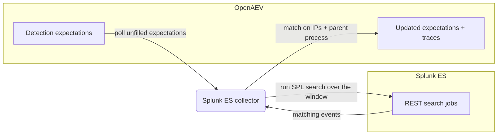
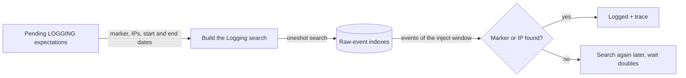

# OpenAEV Splunk Enterprise Security Collector

The Splunk Enterprise Security collector validates OpenAEV detection and logging expectations against
[Splunk Enterprise Security](https://www.splunk.com/en_us/products/enterprise-security.html), Splunk's SIEM. After
OpenAEV agents execute attacks, the collector runs REST search jobs against Splunk and correlates the returned events
with the related injects to confirm whether the activity was detected (an alert was raised) or logged (the raw events
reached Splunk).

## Table of Contents

- [OpenAEV Splunk Enterprise Security Collector](#openaev-splunk-enterprise-security-collector)
  - [Table of Contents](#table-of-contents)
  - [Introduction](#introduction)
  - [Requirements](#requirements)
  - [Configuration variables](#configuration-variables)
    - [OpenAEV environment variables](#openaev-environment-variables)
    - [Base collector environment variables](#base-collector-environment-variables)
    - [Splunk ES collector environment variables](#splunk-es-collector-environment-variables)
    - [Query template](#query-template)
    - [Logging search template](#logging-search-template)
  - [Deployment](#deployment)
    - [Docker Deployment](#docker-deployment)
    - [Manual Deployment](#manual-deployment)
  - [Usage](#usage)
  - [Behavior](#behavior)
    - [Detection expectations](#detection-expectations)
    - [Logging expectations](#logging-expectations)
  - [Required permissions and API endpoints](#required-permissions-and-api-endpoints)
  - [Debugging](#debugging)
  - [Additional information](#additional-information)

## Introduction

OpenAEV (Breach and Attack Simulation) raises "expectations" each time it executes an inject (a simulated attack) on an
endpoint: a DETECTION expectation (the security product should raise an alert), a PREVENTION expectation (the
security product should block the action) and/or a LOGGING expectation (the action should at least appear in the
logs). This collector connects to Splunk Enterprise Security, registers a
`SecurityPlatform` of type `SIEM`, and periodically reconciles those expectations with the events returned by the Splunk
REST search API, marking each expectation as detected/not detected and attaching a trace that links back to the Splunk ES
search results. Splunk ES is a detection and log source, so this collector validates DETECTION expectations and, when
enabled, LOGGING expectations; PREVENTION expectations are not supported.

## Requirements

- OpenAEV Platform >= 1.19.0
- A Splunk Enterprise Security instance with the REST API reachable (typically on management port 8089)
- A Splunk user account with REST API search access and read access to the configured events index
- For LOGGING expectations (optional): the Splunk indexes that receive the raw endpoint logs (for example Sysmon or
  Windows event logs), readable by the same Splunk user. The Enterprise Security app is not needed for Logging: a plain
  Splunk Enterprise instance works.
- For a manual (non-Docker) deployment: Python >= 3.14 and [Poetry](https://python-poetry.org/) >= 2.1

## Configuration variables

The collector is configured either through environment variables (recommended, read from the `.env` file for a
Docker deployment) or through a `config.yml` file (for a manual deployment). Copy the provided
`src/.env.sample` / `src/config.yml.sample` and fill in the values flagged with `ChangeMe`.

### OpenAEV environment variables

| Parameter         | config.yml          | Docker environment variable | Mandatory | Description                                                                              |
|-------------------|---------------------|-----------------------------|-----------|------------------------------------------------------------------------------------------|
| OpenAEV URL       | `openaev.url`       | `OPENAEV_URL`               | Yes       | The URL of the OpenAEV platform. Must be reachable from where the collector runs.        |
| OpenAEV Token     | `openaev.token`     | `OPENAEV_TOKEN`             | Yes       | The administrator token of the OpenAEV platform.                                         |
| OpenAEV Tenant ID | `openaev.tenant_id` | `OPENAEV_TENANT_ID`         | No        | Tenant identifier for multi-tenant deployments. When set, it must be a valid UUID.       |

### Base collector environment variables

| Parameter        | config.yml            | Docker environment variable | Default   | Mandatory | Description                                                                                            |
|------------------|-----------------------|-----------------------------|-----------|-----------|--------------------------------------------------------------------------------------------------------|
| Collector ID     | `collector.id`        | `COLLECTOR_ID`              | /         | Yes       | A unique `UUIDv4` identifier for this collector instance.                                               |
| Collector Name   | `collector.name`      | `COLLECTOR_NAME`            | Splunk ES | No        | The name of the collector as shown in OpenAEV.                                                          |
| Collector Period | `collector.period`    | `COLLECTOR_PERIOD`          | PT1M      | No        | Interval between two runs, as an ISO 8601 duration (e.g. `PT1M` = 1 minute).                            |
| Log Level        | `collector.log_level` | `COLLECTOR_LOG_LEVEL`       | error     | No        | Verbosity of the logs. One of `debug`, `info`, `warn`, `error`.                                         |
| Platform         | `collector.platform`  | `COLLECTOR_PLATFORM`        | SIEM      | No        | The `SecurityPlatform` type registered in OpenAEV. One of `EDR`, `XDR`, `SIEM`, `SOAR`, `NDR`, `ISPM`.  |

### Splunk ES collector environment variables

| Parameter      | config.yml                 | Docker environment variable | Default      | Mandatory | Description                                                                              |
|----------------|----------------------------|-----------------------------|--------------|-----------|-----------------------------------------------------------------------------------------|
| Base URL       | `splunk_es.base_url`       | `SPLUNKES_BASE_URL`         | /            | Yes       | Splunk ES management URL (e.g. `https://splunk.company.com:8089`).                       |
| Username       | `splunk_es.username`       | `SPLUNKES_USERNAME`         | /            | Yes       | Splunk username with REST API search permissions.                                       |
| Password       | `splunk_es.password`       | `SPLUNKES_PASSWORD`         | /            | Yes       | Splunk user password.                                                                    |
| Alerts Index   | `splunk_es.alerts_index`   | `SPLUNKES_ALERTS_INDEX`     | notable      | No        | Splunk index to search for security alerts.                                              |
| Time Window    | `splunk_es.time_window`    | `SPLUNKES_TIME_WINDOW`      | PT1H         | No        | Default search window when no date signatures are provided, as an ISO 8601 duration.     |
| Offset         | `splunk_es.offset`         | `SPLUNKES_OFFSET`           | PT2M         | No        | Delay between retry attempts to absorb alert ingestion latency, as an ISO 8601 duration. |
| Max Retry      | `splunk_es.max_retry`      | `SPLUNKES_MAX_RETRY`        | 5            | No        | Maximum number of retry attempts after the initial search returns no results.            |
| Query Template | `splunk_es.query_template` | `SPLUNKES_QUERY_TEMPLATE`   | *(built-in)* | No        | Custom SPL query template with placeholders (leave empty to use the default below).      |
| Logging Enabled | `splunk_es.logging_enabled` | `SPLUNKES_LOGGING_ENABLED` | false | No | Validate LOGGING expectations by searching the raw-event indexes. Requires `SPLUNKES_LOGGING_INDEXES`. |
| Logging Indexes | `splunk_es.logging_indexes` | `SPLUNKES_LOGGING_INDEXES` | / | When Logging is enabled | Comma-separated raw-event indexes or patterns (e.g. `sysmon,wineventlog,net*`), written as is in `index IN (...)`. No default on purpose. |
| Logging Query Template | `splunk_es.logging_query_template` | `SPLUNKES_LOGGING_QUERY_TEMPLATE` | *(built-in)* | No | Custom SPL template of the Logging search (leave empty to use the built-in search, see [Logging search template](#logging-search-template)). |
| Logging Max Interval | `splunk_es.logging_max_interval` | `SPLUNKES_LOGGING_MAX_INTERVAL` | PT15M | No | Longest wait between two searches of the same LOGGING expectation, as an ISO 8601 duration of at most `PT1H`. |

With `SPLUNKES_LOGGING_ENABLED=true`, a missing index list or an invalid `SPLUNKES_LOGGING_MAX_INTERVAL` stops the
collector at startup, so the mistake is seen at once. With Logging off, an invalid `SPLUNKES_LOGGING_MAX_INTERVAL` is
ignored with a warning. `SPLUNKES_LOGGING_QUERY_TEMPLATE` is checked at startup even with Logging off: an unknown
placeholder stops the collector, Detection included. Leave it empty when Logging is off.

### Query template

`SPLUNKES_QUERY_TEMPLATE` lets you customize the SPL query used to fetch security events. The query template supports the
following placeholders, resolved at runtime:

| Placeholder            | Description                                                                  |
|------------------------|------------------------------------------------------------------------------|
| `{alerts_index}`       | The configured Splunk index (`SPLUNKES_ALERTS_INDEX`).                        |
| `{source_ips}`         | Source IP values quoted for the Splunk `IN` operator (`*` if none).          |
| `{target_ips}`         | Target IP values quoted for the Splunk `IN` operator (`*` if none).          |
| `{hostnames}`          | Hostname values quoted for the Splunk `IN` operator (`*` if none).           |
| `{start_date}`         | Start date from signatures, or a relative time fallback (e.g. `-3600s`).      |
| `{end_date}`           | End date from signatures, or `now` fallback.                                  |

The query must include `| table _time` for proper alert parsing. The default template is:

```spl
index={alerts_index} (src_ip IN ({source_ips}) OR src IN ({source_ips}) OR source_ip IN ({source_ips}) OR client_ip IN ({source_ips})) (dst_ip IN ({target_ips}) OR dest IN ({target_ips}) OR dest_ip IN ({target_ips}) OR destination_ip IN ({target_ips}) OR server_ip IN ({target_ips})) (host IN ({hostnames}) OR hostname IN ({hostnames}) OR host_name IN ({hostnames})) earliest={start_date} latest={end_date} | table _time, src_ip, src, source_ip, client_ip, dst_ip, dest, dest_ip, destination_ip, server_ip, host, hostname, signature, rule_name, event_type, severity, url_path, _raw | sort -_time
```

Signature values that are not part of the enough-filter (process names, emails, hashes, custom headers, ...) are not query placeholders: they are matched after the fetch with a raw-text regex over each fetched alert's `_raw` field. An implant parent process name additionally matches through its callback URL rebuilt from the embedded UUIDs, because network events never show the `.exe` — which is why the projection carries `url_path` (the converter rebuilds the full implant name from it).

### Logging search template

`SPLUNKES_LOGGING_QUERY_TEMPLATE` lets you replace the built-in Logging search, for example to keep only some source
types. Leave it empty to use the built-in search. The template supports the following placeholders:

| Placeholder    | Description                                                                                    |
|----------------|------------------------------------------------------------------------------------------------|
| `{indexes}`    | The configured indexes (`SPLUNKES_LOGGING_INDEXES`), as written.                               |
| `{earliest}`   | Start of the inject window, in epoch seconds, rounded down.                                    |
| `{latest}`     | End of the inject window plus one second, in epoch seconds (Splunk's `latest` is exclusive).   |
| `{terms}`      | The marker, its callback URL path and the IPs, quoted and joined with `OR` (full-text search). |
| `{source_ips}` | Source IP values quoted for the Splunk `IN` operator (`""` if none, so it matches nothing).    |
| `{target_ips}` | Target IP values quoted for the Splunk `IN` operator (`""` if none, so it matches nothing).    |

The search must return the `_time`, `index` and `_raw` fields (for example with `| table _time, index, _raw`): rows
without them are skipped. A template that does not start with `search` or `|` gets `search ` added in front. An unknown
placeholder stops the collector at startup; write a literal brace as `{{` or `}}`. The built-in template is:

```spl
search index IN ({indexes}) earliest={earliest} latest={latest} ({terms}) | table _time, index, host, sourcetype, _raw
```

For example, to search only the Windows event logs:

```spl
search index IN ({indexes}) sourcetype=XmlWinEventLog* earliest={earliest} latest={latest} ({terms}) | table _time, index, host, sourcetype, _raw
```

## Deployment

### Docker Deployment

Build the Docker image (or use the published `openaev/collector-splunk-es` image):

```shell
docker build . -t openaev/collector-splunk-es:latest
```

Create a `.env` file next to `docker-compose.yml` from `src/.env.sample` and fill in your values, then start the
collector with the provided `docker-compose.yml`, which reads the settings it lists from `.env` or from the shell:

```shell
cp src/.env.sample .env
docker compose up -d
```

Settings left out of `.env` keep the collector's defaults. A value written directly in the `environment` section of
`docker-compose.yml` (`VAR=value`) takes precedence over `.env`. To check what actually reached the collector:

```shell
docker compose exec collector-splunkes env | grep -E '^(OPENAEV|COLLECTOR|SPLUNKES)_'
```

### Manual Deployment with Poetry

1. **Clone and Install Dependencies**:
   ```bash
   git clone <repository-url>
   cd <your-collector>
   poetry install
   ```

2. **Configure the Collector**:
    - Copy `src/config.yml.sample` to `src/config.yml`
    - Update configuration values or set environment variables

3. **Run the Collector**:
   ```bash
   # Using Poetry
   poetry run python -m src
   
   # Or 
   poetry run SplunkESCollector

   # Or direct execution after installing the project and activating the virtual environment:
   SplunkESCollector
   ```

For local development against a checkout of [client-python](https://github.com/OpenAEV-Platform/client-python),
The client-python repository must be cloned at the same level as the collectors repository, so that `../../client-python`
resolves correctly from the collector directory.

```
parent-directory/ 
├── collectors/
│   └── <your-collector>/
└── client-python/
```

Then install the local `client-python` version inside the <your-collector> environment:
```bash
poetry run pip install -e ../../client-python --force-reinstall
```
The `-e` option installs the package in editable mode, allowing local changes in `client-python` to be used immediately
without reinstalling the package.

## Usage

Once started, the collector registers itself (and its `SecurityPlatform`) in OpenAEV and then runs automatically every
`COLLECTOR_PERIOD`. No manual interaction is required: as soon as injects produce expectations bound to this collector,
they are reconciled on the next run.

## Behavior



### Detection expectations

On each run, the collector:

1. Fetches the unfilled DETECTION expectations assigned to this collector from OpenAEV. PREVENTION expectations are
   marked invalid because Splunk ES only supports detection.
2. Builds an SPL query by resolving the (configurable) query template from the expectation signatures: source/target
   IPs, the implant callback URL paths and implant process names derived from the parent process name, the alerts index,
   and the time range (from the start/end date signatures or a relative window from `SPLUNKES_TIME_WINDOW`).
3. Runs a oneshot search job (`POST /services/search/jobs` with `exec_mode=oneshot`, `output_mode=json`).
4. Retries up to `SPLUNKES_MAX_RETRY` times, waiting `SPLUNKES_OFFSET` between attempts and progressively widening the
   relative window, to absorb alert ingestion latency.
5. Matches events against the expectation signatures: the `parent_process_name` signature must match and, when IP
   signatures are present, at least one source or destination IP must match. Each matched DETECTION expectation is marked
   `Detected` and gets an expectation trace linking to the Splunk ES search results.

Expectations that remain unmatched after all retries are left for OpenAEV to mark as failed (`Not Detected`) once they
expire.

### Logging expectations

A LOGGING expectation asks one question: did the action of the inject reach the logs? The collector answers it from the
raw events (Sysmon, Windows event logs, firewall logs, ...), not from the notable events. Logging is off by default:
set `SPLUNKES_LOGGING_ENABLED=true` and `SPLUNKES_LOGGING_INDEXES` to turn it on. The collector then declares LOGGING
to OpenAEV next to DETECTION and PREVENTION.



On each run, before the Detection pass, the collector:

1. Fetches the pending LOGGING expectations assigned to this collector.
2. Skips the ones without an end date yet (the inject is still running). They are searched on a later run.
3. Builds one search per expectation from its signatures:
   - the implant marker (`parent_process_name`, e.g. `oaev-implant-<inject>-agent-<agent>`) and the end of its
     callback URL path (`injects/<inject>/<agent>/executable-payload`), since network events only show the URL. The
     end of the path matches both the tenant route that current implants call
     (`/api/tenants/<tenant>/injects/...`) and the older `/api/injects/...` route;
   - the source and target IPs;
   - the window from `start_date` to `end_date`, rounded outwards to the second.

   The host name is not used: in Splunk, `host` is often the log forwarder, not the machine that ran the inject.
4. Runs the search on `SPLUNKES_LOGGING_INDEXES`, with the built-in search or `SPLUNKES_LOGGING_QUERY_TEMPLATE`. Every
   event of the window is read, and Splunk has up to 120 seconds to answer.
5. Marks the expectation `Logged` when one event of the window contains the marker or one of the IPs, and adds a trace
   with the event time, the match type (`marker`, `source_ip` or `target_ip`) and a link to the search in Splunk. When
   several events match, the marker wins over a source IP, a source IP over a target IP, then the earliest event wins.
6. Otherwise searches it again later: the first wait is `COLLECTOR_PERIOD`, then the wait doubles after each search
   without a match, up to `SPLUNKES_LOGGING_MAX_INTERVAL`.

Example: an inject that ran from `2026-11-04T10:00:00Z` to `2026-11-04T10:00:42.300Z` from `192.168.2.4`, with
`SPLUNKES_LOGGING_INDEXES=sysmon,wineventlog`, gives this search (UUIDs shortened):

```spl
search index IN (sysmon,wineventlog) earliest=1793786400 latest=1793786444
    ("oaev-implant-<inject>-agent-<agent>" OR "injects/<inject>/<agent>/executable-payload" OR "192.168.2.4")
| table _time, index, host, sourcetype, _raw
```

Good to know:

- **The collector never writes `Not Logged`.** OpenAEV does, when the expectation expires. A Splunk error or an empty
  search only means "search again later".
- **A marker match is stronger than an IP match.** The marker identifies the inject itself. An IP only shows that the
  host logged something during the window, which may be unrelated activity. The trace match type tells them apart.
- **Splunk returns at most 50,000 events per search** (`maxresultrows` in `limits.conf`). On very busy indexes, narrow
  the search with `SPLUNKES_LOGGING_QUERY_TEMPLATE` (source types, fields) so the inject's events are not cut off.
- **Event times must be right.** The window is compared with the event `_time` in Splunk. If a source sends its events
  with a wrong time zone, they fall outside the window and are not found: check the `TZ` setting of the source type.
- **Detection is never blocked.** The Logging pass starts no new search after one `COLLECTOR_PERIOD`; the remaining
  expectations go first on the next run. An error in the Logging pass never stops the Detection pass.
- **A run can last longer than `COLLECTOR_PERIOD`.** The Logging pass runs once per run, and the Detection pass of the
  same run can wait up to 5 minutes for its own expectations. Logging searches can then be further apart than the
  configured waits.

At startup and while running, Logging reacts to errors as follows:

| Situation                                                                       | What happens                                                                   |
|---------------------------------------------------------------------------------|--------------------------------------------------------------------------------|
| Logging enabled without index, or with an invalid max interval                  | The collector does not start (configuration error).                            |
| Logging search template with an unknown placeholder, even with Logging off      | The collector does not start (configuration error).                            |
| None of the Logging indexes exists or is readable (checked once at startup)     | LOGGING is withdrawn from the collector; Detection goes on.                    |
| Some Logging indexes are missing                                                | An error log lists them; Logging goes on with the others.                      |
| Splunk answers 401 or 403 to a Logging search or to the startup check           | Logging stops until the collector restarts and LOGGING is withdrawn.           |
| Splunk error, timeout or unreadable answer                                      | A warning is logged and the expectation is searched again later.               |
| OpenAEV cannot return the LOGGING expectations                                  | The Logging pass is skipped for this run.                                      |

When LOGGING is withdrawn, OpenAEV stops waiting for this collector on LOGGING expectations. Fix the cause, then
restart the collector to declare LOGGING again.

## Required permissions and API endpoints

- Required permission: a Splunk user with REST API search access and read access to the configured events index
  (e.g. `main`).
- For LOGGING expectations: read access to every index of `SPLUNKES_LOGGING_INDEXES` (the role's allowed indexes).
  An index the role cannot read is reported as missing at startup, since Splunk silently returns no event for it.
- API endpoints used:
  - `POST /services/search/jobs` (oneshot search via the Splunk REST API, authenticated with HTTP basic authentication),
    used for the Detection searches, the Logging searches and the startup Logging index check (`| eventcount`)
- Reference: [Splunk roles and capabilities](https://docs.splunk.com/Documentation/Splunk/latest/Security/Aboutusersandroles)
  and the [Splunk REST API reference](https://docs.splunk.com/Documentation/Splunk/latest/RESTREF/RESTsearch)

## Debugging

Set `COLLECTOR_LOG_LEVEL=debug` to get verbose logs, including the resolved SPL query, the search job issued, and the
matching decisions. Common causes of "nothing detected" are the wrong `SPLUNKES_ALERTS_INDEX`, a `SPLUNKES_TIME_WINDOW`
shorter than your ingestion latency, or a custom `SPLUNKES_QUERY_TEMPLATE` that omits `| table _time` (which breaks field
extraction). Make sure `SPLUNKES_BASE_URL` targets the Splunk management port (typically 8089), not the web UI port.

For Logging, `COLLECTOR_LOG_LEVEL=info` prints the startup index check and one summary per run
(`Logging pass completed: ... fetched, ... logged, ... no match, ... errors`); `debug` adds why each expectation was not
logged yet. Common causes of "nothing logged" are an index list that does not hold the endpoint logs, events whose
`_time` is shifted by a wrong time zone, an endpoint that does not log process creation or network connections
(for example Sysmon not installed), or a custom `SPLUNKES_LOGGING_QUERY_TEMPLATE` that drops `_time`, `index` or `_raw`.

## Additional information

- This collector validates detection and, when enabled, logging; it does not support prevention expectations.
- The Logging search is customizable via `SPLUNKES_LOGGING_QUERY_TEMPLATE`; `SPLUNKES_QUERY_TEMPLATE` only applies to
  Detection.
- The SPL query is fully customizable via `SPLUNKES_QUERY_TEMPLATE`; a custom template must keep the `| table _time`
  pipe so that the resulting events can be parsed.
- TLS certificate verification is disabled for requests to Splunk; deploy the collector on a trusted network segment.
- The required permissions and endpoints reflect the current implementation. Splunk may change its API over time, so
  always confirm against the official documentation before deploying.
